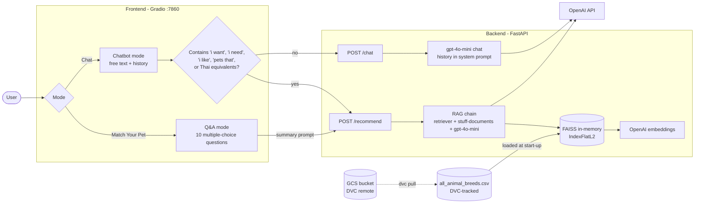
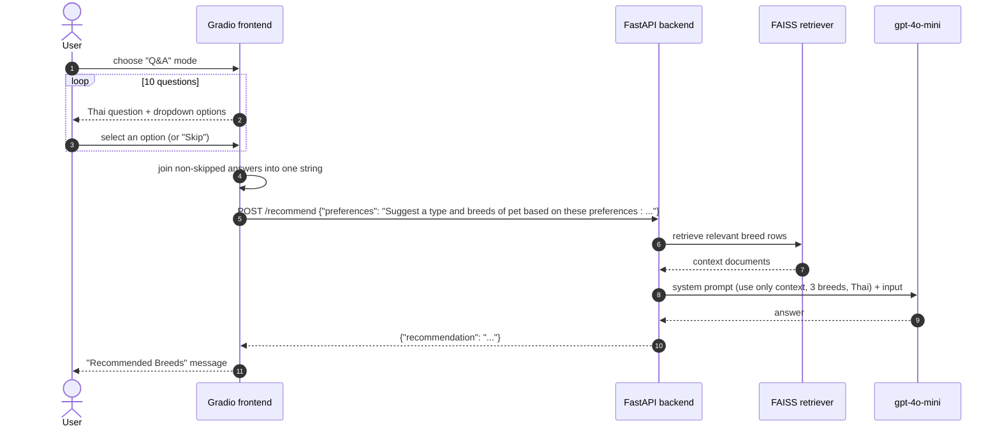
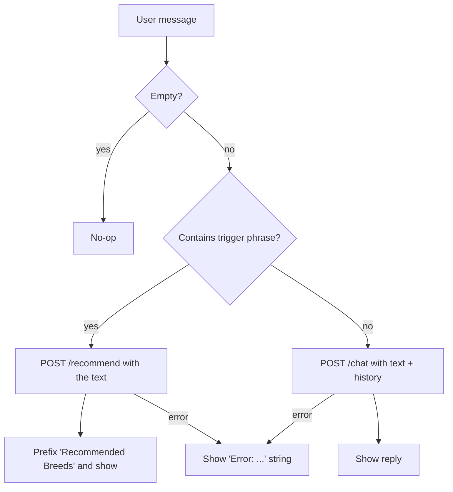

# Pet Match MLOps

**A Thai-language AI assistant that recommends pet breeds for your lifestyle, using RAG over a breed CSV, with a two-mode Gradio UI and a FastAPI backend.**

    -945DD6?style=for-the-badge&logo=dvc&logoColor=white) 

> **Status: course/MLOps prototype.** It works as a two-service demo; there are no tests, no CI and no evaluation in the repo. See [Security and limitations](#security-and-limitations) before deploying; notably, two credential files are tracked in git.

Last updated: 2026-11-03.

---

## Thai summary (สรุปภาษาไทย)

Pet Match คือผู้ช่วยแนะนำสายพันธุ์สัตว์เลี้ยงที่เหมาะกับไลฟ์สไตล์ มี 2 โหมด: (1) Q&A ตอบคำถาม 10 ข้อ (ขนาด ความขี้เล่น การเข้ากับเด็ก การดูแลขน ความฉลาด ฯลฯ) แล้วระบบสรุปความต้องการเป็นข้อความส่งไปให้ backend ค้นข้อมูลจาก `all_animal_breeds.csv` ด้วย RAG (OpenAI embeddings + FAISS) และให้ `gpt-4o-mini` แนะนำ 3 สายพันธุ์พร้อมเหตุผลเป็นภาษาไทย (2) Chatbot คุยอิสระ ถ้าข้อความมีคำเช่น "อยากได้" หรือ "i want" จะส่งเข้า RAG ถ้าไม่ใช่จะคุยทั่วไป ไฟล์ข้อมูลจัดการด้วย DVC (remote บน Google Cloud Storage) หมายเหตุ: เป็นโปรโตไทป์ และมีไฟล์ credential ถูก track ใน git (ดูหัวข้อ Security and limitations)

---

## Problem

Choosing a pet breed means weighing size, energy, grooming, noise, child-friendliness and budget. Generic web answers ignore the user's situation. This app turns the user's preferences into a retrieval query over a structured breed table and asks an LLM to answer only from the retrieved rows.

## Design

| Decision | What the code does |
|---|---|
| Grounded answers | The recommend prompt says "Use only the information from {context}", recommend 3 breeds with reasons, apologize if no data, answer in friendly Thai with emoji. |
| Two modes, one backend | `/recommend` is the RAG chain; `/chat` is a plain `gpt-4o-mini` call with the chat history injected into the system prompt. |
| Rule-based routing in the UI | In chatbot mode the frontend sends the text to `/recommend` if it contains `i want`, `i need`, `i like`, `pets that`, `อยากได้` or `สัตว์เลี้ยงที่`; otherwise to `/chat`. |
| Index built at start-up | The backend loads the CSV, embeds all rows with OpenAI embeddings into an in-memory FAISS `IndexFlatL2` on every boot. |
| Versioned data | The CSV is not in git; it is tracked with DVC and stored in a GCS bucket. |
| Split services | Separate Dockerfiles for backend and frontend. |

---

## Repository layout

```
pet-match-mlops/
├── backend/
│   ├── backend.py                    FastAPI app: /recommend (RAG) and /chat
│   ├── data/
│   │   ├── all_animal_breeds.csv.dvc DVC pointer (md5 a238f9bb..., 48,439 bytes)
│   │   └── .gitignore                keeps the CSV itself out of git
│   ├── requirements.txt              pinned dependencies
│   ├── Dockerfile                    python:3.10.5-slim, runs backend.py
│   └── .env                          tracked in git (see Security)
├── frontend/
│   ├── frontend.py                   Gradio UI: Q&A mode and Chatbot mode
│   ├── logo.gif
│   ├── requirements.txt              gradio 5.20.1, requests, loguru, ...
│   └── Dockerfile                    python:3.10.5-slim, EXPOSE 7860
├── .dvc/config                       DVC remote: gs://mlops-project-dvc-bucket
├── .dvcignore
└── service_account.json              placeholder file tracked in git (see Security)
```

---

## Tech stack

<p align="center">
  
</p>

| Layer | Choice (from `requirements.txt` and code) |
|---|---|
| Frontend | Gradio 5.20.1, `requests`, `loguru` |
| Backend | FastAPI 0.115.11, Uvicorn 0.34.0, Pydantic 2.10.6 |
| RAG | LangChain 0.3.20 (`create_retrieval_chain`, `create_stuff_documents_chain`), `langchain-openai` 0.3.8, `CSVLoader` |
| Vector store | `faiss-cpu` 1.10.0, in-memory `IndexFlatL2` + `InMemoryDocstore` |
| Models | `OpenAIEmbeddings()` (library default model), `gpt-4o-mini` for both chains |
| Data versioning | DVC with a Google Cloud Storage remote |
| Containers | Docker, base `python:3.10.5-slim` |

---

## System architecture



## Flow 1: Q&A recommendation (sequence)



The 10 questions (internal keys): size, playfulness, children friendly, grooming, intelligence, other pets friendly, life span, exercise requirements, purchase price (options in baht: under 500, 500-1000, over 1000), barking.

## Flow 2: Chatbot mode routing



---

## API

| Method | Path | Request body | Response | Notes |
|---|---|---|---|---|
| POST | `/recommend` | `{"preferences": "<text>"}` | `{"recommendation": "<text>"}` | RAG chain; HTTP 500 with detail on any exception |
| POST | `/chat` | `{"input_text": "<text>", "history": [ ... ]}` | `{"history": "<assistant reply>"}` | The response key is named `history` but holds only the latest reply |

## Data

`backend/data/all_animal_breeds.csv` is not in git. Its DVC pointer records one output, `all_animal_breeds.csv` (md5 `a238f9bb36e7d4e9d037dbd57d3898d6`, 48,439 bytes). The column schema is not documented in the repo and I did not have access to the file, so it is not described here.

---

## How to run

Only commands and values taken from repo files are listed. I did not run or install anything.

**1. Get the data (needs access to the DVC remote).** `.dvc/config` points to `gs://mlops-project-dvc-bucket` and expects credentials at `../service_account.json`. The committed `service_account.json` is a tiny placeholder, not a usable key; supply your own credentials, then run the standard DVC command (ASSUMPTION: `dvc` is installed):

```bash
dvc pull
```

**2. Backend.** Needs an OpenAI key in the environment or a `.env` read by `python-dotenv` (the code calls `load_dotenv()` and the OpenAI SDK reads `OPENAI_API_KEY`). Run from `backend/` so the relative `data/` path resolves:

```bash
cd backend
pip install -r requirements.txt
python backend.py
```

**Port mismatch to be aware of:** `backend.py` serves on port **80** (`uvicorn.run(..., port=80)`), while `frontend.py` calls `http://<BACKEND_URL>:8088`. Map the container/host port accordingly (for example host 8088 to container 80 when using Docker), or edit one side. (ASSUMPTION: this mapping is what the authors intended; there is no compose file in the repo.)

**3. Frontend.** Set `BACKEND_URL` to the backend host (default `127.0.0.1`) and run:

```bash
cd frontend
pip install -r requirements.txt
BACKEND_URL=127.0.0.1 python frontend.py
```

The UI serves on `0.0.0.0:7860`.

**Docker:** each service has a Dockerfile (`backend/Dockerfile`, `frontend/Dockerfile`) that installs `requirements.txt` and runs the script; no `docker run` or compose invocation is documented in the repo.

## Testing and evaluation

None in the repository: no unit tests, no retrieval or answer-quality evaluation, no CI. Recommendation quality depends entirely on the CSV contents and the prompt, and has not been measured. Suggested (not implemented): a small set of lifestyle profiles with expected breeds, and a check that every recommended breed exists in the CSV.

---

## Security and limitations

| Issue | Detail |
|---|---|
| Tracked credential files | `backend/.env` and `service_account.json` are tracked in git. I did not open `.env`. `service_account.json` is a 24-byte placeholder. Treat anything that was ever in `.env` as exposed: rotate it, `git rm --cached`, add both to `.gitignore`, and scan history with gitleaks. |
| Unauthenticated API | `/recommend` and `/chat` have no auth, rate limit or input-size limit; each call costs OpenAI tokens. |
| Index rebuilt on every start | All CSV rows are embedded at boot (extra latency and cost); the index is not persisted. |
| Prompt handling | Chat history is interpolated into a system prompt with an f-string, so user text can influence instructions (prompt injection). |
| Error leakage | Exceptions are returned in HTTP 500 `detail`. |
| Plain HTTP between services | The frontend builds an `http://` URL. |
| Keyword routing | Chatbot routing is a hard-coded phrase list; many valid requests will fall through to plain chat without retrieval. |
| Not expert advice | Breed suggestions are LLM output over a CSV and are not veterinary or welfare advice. |
| Privacy | User text goes to OpenAI; no PII masking. Review against PDPA before real users. |

## Credits

Breed data tracked via DVC (source not stated in the repo). Built with LangChain, FAISS, FastAPI, Gradio and OpenAI models.
