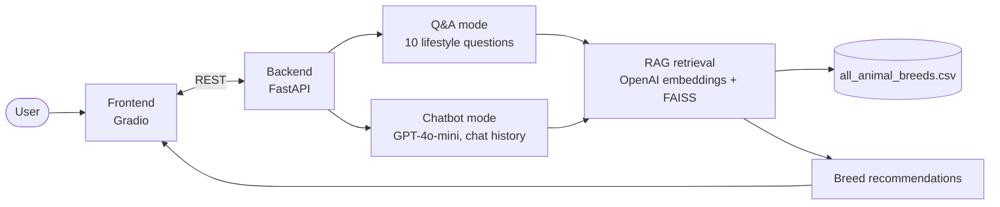

<div align="center">

# Pet Match MLOps

**A Thai-language AI assistant that recommends pets for your lifestyle with RAG.**

   

</div>

## Tech stack

<p align="center">
  
</p>

## Architecture



---

## 📝 ภาพรวม (Overview)

**Pet Match MLOps** คือโปรเจกต์ที่พัฒนาระบบผู้ช่วยอัจฉริยะ (AI Assistant) สำหรับการแนะนำสัตว์เลี้ยงที่เหมาะสมกับไลฟ์สไตล์และความต้องการของผู้ใช้ โดยผสมผสานระหว่างเทคโนโลยี **Large Language Models (LLM)** และ **Retrieval-Augmented Generation (RAG)** เพื่อให้คำแนะนำที่แม่นยำและเป็นธรรมชาติ

ผู้ใช้สามารถโต้ตอบกับระบบได้ 2 รูปแบบ คือ:

1.  **โหมดแนะนำสัตว์เลี้ยง (Recommendation Mode):** ผู้ใช้ตอบคำถามเป็นชุดเพื่อระบุความต้องการของตนเอง จากนั้นระบบจะใช้เทคนิค RAG เพื่อค้นหาและแนะนำพันธุ์สัตว์เลี้ยงที่เหมาะสมที่สุดจากฐานข้อมูล
2.  **โหมดแชทบอท (Chatbot Mode):** ผู้ใช้สามารถพูดคุยกับ AI Assistant ได้อย่างอิสระเพื่อสอบถามข้อมูลทั่วไปเกี่ยวกับสัตว์เลี้ยง ซึ่งขับเคลื่อนด้วย **GPT-4o-mini**

โปรเจกต์นี้ถูกออกแบบตามหลักการ **MLOps** โดยแยกส่วน Frontend และ Backend ออกจากกันอย่างชัดเจน ทำให้ง่ายต่อการพัฒนา, ทดสอบ, และนำไปใช้งาน (Deployment)

-----

## ✨ ฟีเจอร์หลัก (Key Features)

  * **ระบบแนะนำสัตว์เลี้ยงอัจฉริยะ:** ใช้เทคนิค RAG ร่วมกับ **OpenAI Embeddings** และ **FAISS** Vector Store เพื่อค้นหาข้อมูลสัตว์เลี้ยงจากไฟล์ CSV และสร้างคำแนะนำที่ตรงกับความต้องการของผู้ใช้
  * **แชทบอท AI ผู้ช่วย:** ขับเคลื่อนด้วย **GPT-4o-mini** สามารถพูดคุยตอบโต้เป็นภาษาไทยได้อย่างเป็นธรรมชาติในหัวข้อที่เกี่ยวกับสัตว์เลี้ยง พร้อมจดจำบริบทการสนทนา (Chat History)
  * **สถาปัตยกรรมแบบ Microservices:** แยกส่วน Frontend (Gradio) และ Backend (FastAPI) ออกจากกัน ทำให้ระบบมีความยืดหยุ่นและง่ายต่อการบำรุงรักษา
  * **ส่วนติดต่อผู้ใช้แบบสองโหมด:** ผู้ใช้สามารถสลับระหว่างโหมด Q\&A สำหรับการแนะนำแบบมีโครงสร้าง และโหมด Chatbot สำหรับการสนทนาทั่วไปได้

-----

## 🛠️ สถาปัตยกรรมและเทคโนโลยีที่ใช้ (Tech Stack & Architecture)

### Frontend

  * **Framework:** **Gradio**
  * **หน้าที่:** สร้างส่วนติดต่อผู้ใช้ (User Interface) สำหรับให้ผู้ใช้โต้ตอบกับระบบ, รับ Input, และแสดงผลลัพธ์ที่ได้จาก Backend
  * **การทำงาน:** ส่ง Request ไปยัง FastAPI endpoints (`/recommend` และ `/chat`) เพื่อขอคำแนะนำหรือคำตอบจากแชทบอท

### Backend

  * **Framework:** **FastAPI**
  * **หน้าที่:** เป็นส่วนที่จัดการ Logic ทั้งหมดของแอปพลิเคชัน ประกอบด้วย 2 Endpoints หลัก:
    1.  `/recommend`: รับค่าความต้องการของผู้ใช้, เรียกใช้ **RAG Chain** เพื่อสร้างคำแนะนำ, และส่งผลลัพธ์กลับไป
    2.  `/chat`: รับข้อความและประวัติการสนทนา, เรียกใช้ **OpenAI API (GPT-4o-mini)** เพื่อสร้างคำตอบ, และส่งผลลัพธ์กลับไป
  * **ฐานข้อมูล:** ใช้ไฟล์ `all_animal_breeds.csv` เป็นแหล่งข้อมูลสำหรับระบบแนะนำ

### AI & Machine Learning

  * **LLMs:** **GPT-4o-mini** จาก OpenAI
  * **RAG Framework:** **LangChain**
  * **Embedding Model:** **OpenAI Embeddings**
  * **Vector Store:** **FAISS** (Facebook AI Similarity Search) สำหรับการค้นหาข้อมูลแบบเวกเตอร์ที่มีประสิทธิภาพสูง

-----

## 🚀 วิธีการติดตั้งและใช้งาน (Installation & Usage)

1.  **Clone a repository:**
    ```bash
    git clone https://github.com/Dxrksvng/pet-match-mlops.git
    cd pet-match-mlops
    ```
2.  **ติดตั้ง Dependencies:**
    ```bash
    pip install -r requirements.txt
    ```
3.  **ตั้งค่า Environment Variables:**
      * สร้างไฟล์ `.env` และกำหนด `OPENAI_API_KEY` ของคุณ
4.  **รัน Backend Server (FastAPI):**
    ```bash
    uvicorn backend:app --host 0.0.0.0 --port 8088
    ```
5.  **รัน Frontend Application (Gradio):**
    ```bash
    python frontend.py
    ```
6.  เปิดเบราว์เซอร์และเข้าไปที่ URL ของ Gradio ที่แสดงใน Terminal เพื่อเริ่มใช้งาน
